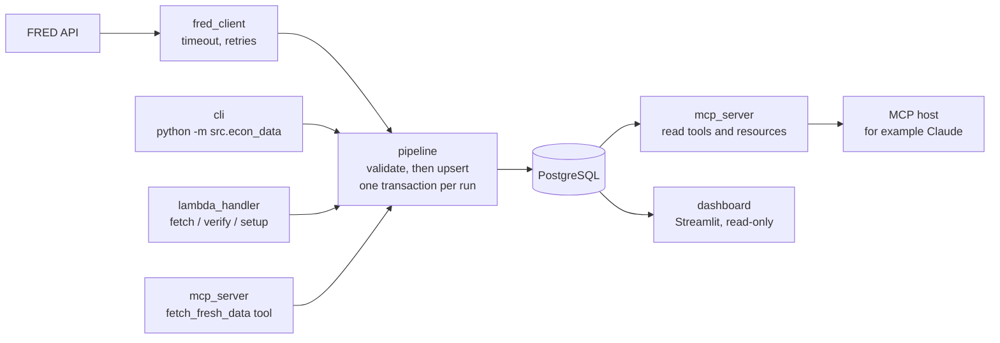
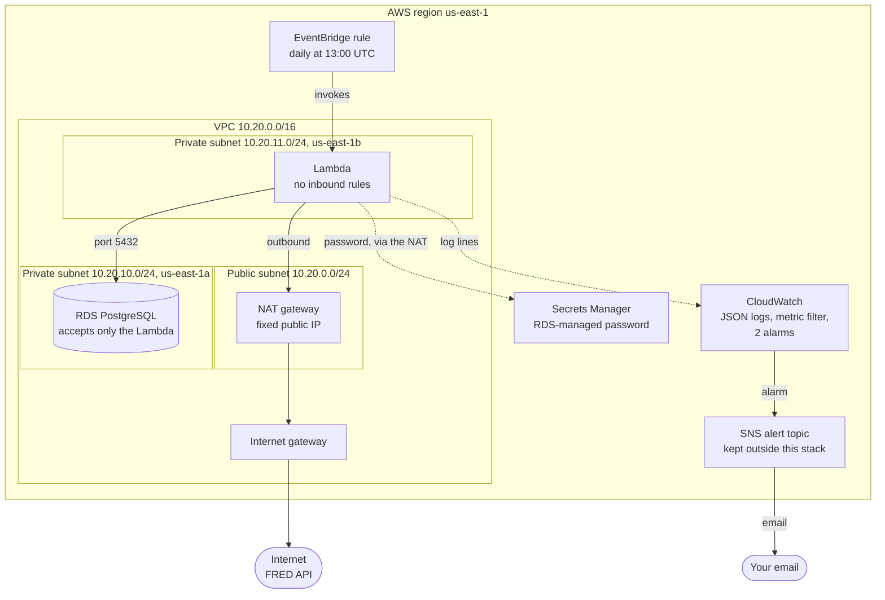

# Economic Data Pipeline

Loads US economic and market indicators from the [FRED API](https://fred.stlouisfed.org/docs/api/fred/) into PostgreSQL, and serves them to AI assistants through an [MCP](https://modelcontextprotocol.io) server.

It tracks six series: three federal funds rates, the monthly average of the funds rate, the S&P 500 and the VIX. Each run fetches the latest observations (or the full history), checks them against valid ranges, and upserts them in one database transaction, so a rerun changes nothing and a value FRED later revises is overwritten.

## Status

| | |
|---|---|
| Runs locally | Yes. Docker Compose starts PostgreSQL; the pipeline loads real FRED data. A full backfill has been run against it, and the Quick start has been followed from a fresh clone on Windows. |
| Tests | Unit tests, plus integration tests that run against a real PostgreSQL server. See [Tests](#tests). |
| MCP server | Works over stdio. A Streamable HTTP mode exists but is bound to localhost and has no authentication. A script checks its answers against the database. See [Checking the server against the database](#checking-the-server-against-the-database). |
| Dashboard | A local Streamlit page that reads the Docker database, read-only. See [Dashboard](#dashboard). |
| AWS | Built with Terraform and tested: a VPC, a private RDS database and a Lambda. The `setup`, `fetch` and `verify` modes have run against real FRED data, and a second `fetch` stored nothing new. It can be deployed from GitHub Actions. The stack is destroyed when it is not in use, because it costs about $1.65 a day while running, so it is usually **not running**. See [Deploying to AWS](#deploying-to-aws). |
| Scheduling | A daily EventBridge rule is defined in Terraform. A scheduled run has been observed on a stack built from nothing: it stored the latest observations with no manual `fetch`, and later runs stored nothing new. A new stack needs `setup` run once first. See [Watching the schedule fire](#watching-the-schedule-fire). |
| CI | GitHub Actions checks every push and pull request: lint, the tests on Python 3.11 and 3.13 against PostgreSQL 16, and Terraform formatting and validation. See [Continuous integration](#continuous-integration). |
| Deploy | A manual GitHub Actions workflow applies or destroys the stack. It signs in to AWS with OpenID Connect, so no AWS keys are stored in GitHub. |
| Monitoring | Logs are structured JSON, and two CloudWatch alarms send email through SNS. The failure alarm is tested end to end. The no-new-data alarm has been seen going to OK after a scheduled run, but not into the alarm state. See [Monitoring](#monitoring). |

## Architecture



Three entry points (the command line, the Lambda handler and the MCP `fetch_fresh_data` tool) call the same pipeline. The MCP read tools and resources, and the dashboard, query the database directly and never write to it. The tables are what they share: neither knows the other exists.

| Module | Job |
|---|---|
| `config` | The six indicators (id, name, units, frequency, valid range, lookback) and the settings read from environment variables and `.env`. Every other module reads from here. |
| `db` | Opens connections. Credentials come from `DB_PASSWORD`, or from AWS Secrets Manager when `DB_SECRET_ARN` is set. |
| `fred_client` | Requests observations from FRED with a timeout and retries. Fails with an error that starts with the series id and never contains the API key. |
| `validate` | Checks each date and value. |
| `pipeline` | Fetch, validate, upsert. Returns one summary per indicator. |
| `cli` | The command line, with a per-indicator table and exit codes. |
| `lambda_handler` | AWS Lambda entry point with `fetch`, `verify` and `setup` modes. |
| `mcp_server` | The MCP server. |

### On AWS



The database and the Lambda sit in private subnets with no route in from the internet. The database's security group accepts port 5432 from the Lambda's security group and from nothing else. The Lambda reaches FRED and Secrets Manager through the NAT gateway. It is attached to both private subnets and is drawn in one of them. EventBridge and Secrets Manager are regional services outside the VPC, and EventBridge calls the Lambda through the Lambda service, not through the network. The Lambda's logs go to CloudWatch, and the alarms publish to an SNS topic that lives outside this stack (see [Monitoring](#monitoring)), so destroying the stack does not remove your email subscription.

## Quick start

You need Python 3.11 or newer, Docker, and a free [FRED API key](https://fred.stlouisfed.org/docs/api/api_key.html).

```
git clone https://github.com/lkhavkin7/Economic_Data.git
cd Economic_Data
python -m venv .venv
```

Activate the virtual environment: `.venv\Scripts\activate` on Windows, `source .venv/bin/activate` on macOS and Linux. Then:

```
pip install -r requirements-dev.txt
```

Create your settings file from the template (`copy .env.example .env` on Windows, `cp .env.example .env` elsewhere). Open `.env` and fill in `DB_PASSWORD` (choose any password) and `FRED_API_KEY`. On Windows, also set `DB_HOST=127.0.0.1`, and if Docker reports that port 5432 is forbidden, set `DB_PORT=15432` (see [Troubleshooting](#troubleshooting)). `.env` is ignored by git; never commit it.

Start the database and load the data:

```
docker compose up -d --wait
python -m src.econ_data --backfill
```

Check what was stored:

```
docker compose exec db psql -U econ -d econ_data -c "SELECT indicator_id, COUNT(*), MAX(date) FROM economic_indicators GROUP BY 1 ORDER BY 1"
```

From then on, `python -m src.econ_data` fetches only the latest observations. To look at the data, see [Dashboard](#dashboard).

The database schema (`db/schema.sql`) is applied only the first time the container starts with an empty data volume. `docker compose down` stops the database and keeps the data. `docker compose down -v` also deletes the data, so the next start begins from scratch.

## Configuration

Settings come from environment variables or from `.env` in the folder you run from. If both set the same value, the environment variable wins.

| Variable | Default | Meaning |
|---|---|---|
| `DB_PASSWORD` | none | Database password. Required unless `DB_SECRET_ARN` is set. |
| `DB_SECRET_ARN` | none | ARN of an AWS Secrets Manager secret holding `{"username": ..., "password": ...}`. Used only when `DB_PASSWORD` is empty. |
| `FRED_API_KEY` | none | Your FRED API key. |
| `DB_HOST` | `localhost` | Use `127.0.0.1` on Windows: `localhost` tries IPv6 first and every connection stalls. |
| `DB_PORT` | `5432` | Also the host port Docker Compose publishes the database on. |
| `DB_NAME` | `econ_data` | |
| `DB_USER` | `econ` | |

## Running the pipeline

```
python -m src.econ_data                          latest observations of every indicator
python -m src.econ_data --backfill               full history of every indicator
python -m src.econ_data --indicator DFF SP500    only the named indicators
```

Each run prints one line per indicator (example output):

```
indicator    fetched   inserted    updated  unchanged    missing   rejected  status
DFF               10          1          0          9          0          0  ok
DFEDTARU          10          0          0         10          0          0  ok
DFEDTARL          10          0          0         10          0          0  ok
FEDFUNDS           3          0          1          2          0          0  ok
SP500             10          1          0          8          1          0  ok
VIXCLS            10          1          0          9          0          0  ok

6 indicators: 6 ok, 0 failed
```

The columns of a successful run add up: `fetched = missing + rejected + inserted + updated + unchanged`.

| Exit code | Meaning |
|---|---|
| 0 | Every indicator succeeded. |
| 1 | At least one indicator failed, for example FRED returned an error. The indicators that succeeded were still saved. |
| 2 | The run could not complete: bad arguments, bad settings or a database error. Nothing from that run was saved. |

## MCP server

Tools (actions a model can call):

| Tool | Returns |
|---|---|
| `get_latest_indicator` | The newest stored observation of one indicator. |
| `get_indicator_history` | The newest stored observations of one indicator, newest first. `limit` is 1 to 1000, default 10. |
| `fetch_fresh_data` | Runs the pipeline for one indicator or `all`, and returns a summary per indicator. This is the only tool that writes. |

Resources (read-only context, addressed by URI):

| URI | Content |
|---|---|
| `fred://catalog` | Every indicator in the database, with its row count and latest date. |
| `fred://series/{indicator_id}` | The newest 100 stored observations of one indicator. |

Start it:

```
python -m src.econ_data.mcp_server          stdio, launched by an MCP host
python -m src.econ_data.mcp_server http     Streamable HTTP at http://127.0.0.1:8765/mcp
```

`mcp_config.json` is a template for an MCP host's configuration. The server reads its settings the same way the pipeline does, so either start it from the repository folder (where `.env` is) or put the real values in the `env` block of the host's configuration. Not every host expands `${...}` placeholders.

The HTTP mode has no authentication. Keep it on localhost.

### Checking the server against the database

`scripts/check_mcp_against_db.py` starts the real server as a subprocess, the way an MCP host does, and compares what it returns with the same rows read straight from PostgreSQL. It uses its own SQL, so a bug in the server's queries cannot make both sides agree on a wrong answer. For every indicator it makes four checks:

| Check | Compares |
|---|---|
| `latest` | `get_latest_indicator` against the newest row. |
| `history` | `get_indicator_history` against the newest rows. |
| `series` | `fred://series/{indicator_id}` against the newest 100 rows. |
| `catalog` | `fred://catalog` against the row count and latest date. |

Run it from the repository folder, with the database up and filled:

```
python -m scripts.check_mcp_against_db
```

The exit code is 0 when every check matched, and 1 on a mismatch or an empty database.

## Dashboard

A Streamlit page that reads the database and shows what the pipeline has stored. It runs on your computer, and it only reads: its connection is opened read-only, so a bug in it cannot change data.

Run it from the repository folder, with the database up and filled:

```
pip install -r requirements-dashboard.txt
python -m streamlit run dashboard/app.py
```

`requirements-dev.txt` already includes the dashboard's packages (pandas, Plotly and Streamlit), so a development install has them. Use `python -m streamlit`, not `streamlit`: it puts the repository folder on the import path, which the dashboard needs to find the `src` package. The page opens at `http://localhost:8501` and reads the same `.env` settings as the pipeline. After editing a dashboard file, stop it with Ctrl+C and start it again, because Streamlit does not reliably reload modules the page imports.

| Tab | Shows |
|---|---|
| Overview | A tile for each indicator (latest value, change against a month and a year earlier), and a three-panel chart: the funds rate over the Fed's target range, the S&P 500 and the VIX, with a date-range control. |
| Explore | One indicator's whole history, with range buttons and a slider, its table, and a CSV download. |
| Data quality | Each indicator's row count, latest date, days behind and status, and the rows the latest runs wrote. |
| Guide | What each indicator is and how to read its values, and how to read the three kinds of range: the date range, the Fed's target range and the pipeline's valid range. |

| File in `dashboard/` | Job |
|---|---|
| `data.py` | The only file that touches the database. Reads every stored row once, then works out the tile figures, date ranges and data-quality tables from that table. |
| `charts.py` | Builds the Plotly figures and holds the color of each indicator. |
| `tiles.py` | Formats the tiles as HTML, and holds their style sheet. |
| `guide.py` | The text of the Guide tab. The facts it shows (names, frequency, units, valid range) are read from `config`, so it matches what the pipeline enforces. |
| `app.py` | The page: layout, the tabs, and the caching. |

`.streamlit/config.toml` sets Streamlit's own theme (a 90% black background and light blue text), using the same colors as `charts.py`.

How it works:

- **One read, cached.** Streamlit runs the whole script again on every click. The query is cached for 60 seconds, so clicking does not open a new connection or read the tables again. The Reload button reads the database immediately.
- **Changes are measured by date, not by row count.** "A month ago" is the last value on or before that date. A rate changes by a difference in percentage points, because 4% to 5% is one point, not a 25% rise. An index changes by a percent. A change is left empty if the older value is more than 45 days before the date it stands for, so it is never measured across a gap.
- **Only the VIX gets a percentile.** A percentile only means something for a series that returns to a usual range. An index that trends upward, like the S&P 500, would sit near the top almost always.
- **One panel per scale.** The funds rate, the S&P 500 and the VIX have very different scales, so each gets its own panel on a shared date axis instead of two value axes on one plot, which makes unrelated lines look related.
- **Direction is shown by an arrow, not by color.** A rising rate or a rising VIX is not good or bad news in itself.
- **Stale means:** a daily series whose newest observation is more than 7 days old, or a monthly one more than 65 days old.

## AWS Lambda entry point

`lambda_handler` in `src/econ_data/lambda_handler.py` runs the mode named by the event's `mode` key:

| Mode | Does |
|---|---|
| `fetch` (default) | Runs the pipeline for every indicator. If any indicator failed, raises an error after all have been processed, so Lambda records the invocation as failed. |
| `verify` | Returns the row count and latest date stored for each indicator. |
| `setup` | Creates the database if it is missing, then applies `db/schema.sql`. Safe to repeat. |

On a new stack, run `setup` once before the first scheduled `fetch`. The database starts empty, and until its tables exist every scheduled run fails and the failure alarm emails you.

On AWS every log line is a JSON object. The readable sentence is in `message`, and the numbers are separate fields, so CloudWatch can filter and count them:

| `event` | Logged | Fields |
|---|---|---|
| `indicator_summary` | once per indicator | `indicator`, `fetched`, `inserted`, `updated`, `unchanged`, `missing`, `rejected` |
| `indicator_rejections` | when an indicator had rejected observations (a warning) | `indicator`, `rejected` |
| `indicator_failed` | when an indicator failed (an error) | `indicator` |
| `run_summary` | once per `fetch` run, before any failure is raised | `indicators`, `failed`, `inserted`, `updated`, `rows_written` |

For example, `aws logs tail /aws/lambda/econ-data --since 1h --filter-pattern "{ $.event = \"run_summary\" }"` shows only the run summaries (Windows `cmd` quoting).

## Deploying to AWS

The `infra/` folder is Terraform for everything in the [AWS diagram](#on-aws). You need an AWS account, [Terraform](https://developer.hashicorp.com/terraform/install) 1.11 or newer, the AWS CLI v2 signed in to that account, and the FRED API key. Sign in through IAM Identity Center with an administrator user, never with the account's root user.

| File in `infra/` | Creates |
|---|---|
| `backend.tf` | Keeps Terraform's state in an S3 bucket instead of on one computer. |
| `network.tf` | The VPC, one public and two private subnets, the internet gateway and the route tables. |
| `security.tf` | The security groups and their rules, and locks down the VPC's default security group. |
| `nat.tf` | The NAT gateway, its fixed public IP and the private subnets' route to it. |
| `database.tf` | The RDS PostgreSQL 16 server. RDS creates the master password and keeps it in Secrets Manager. |
| `iam.tf` | The Lambda's role: VPC and logging access, plus permission to read that one secret. |
| `lambda.tf` | The Lambda function and its log group. The function logs as JSON. |
| `schedule.tf` | The daily EventBridge rule and the permission that lets it call the Lambda. |
| `monitoring.tf` | The two alarms, and the log metric filter behind one of them. |

### One-time setup: the bootstrap

`infra/bootstrap/` is a separate, small Terraform project that you run once. It builds what the main stack depends on and has to outlive it, so destroying the main stack never touches it. It keeps its own state in a local file, because the bucket for the shared state does not exist until it creates it.

| Creates | Why |
|---|---|
| An S3 bucket for the main stack's state | Private, encrypted and versioned, and protected from deletion by `prevent_destroy`. The state holds the FRED API key, so the bucket must stay private. |
| A GitHub OpenID Connect provider and the role `econ-data-github-deploy` | Lets workflows of this repository, on the `main` and `rewrite` branches only, get one hour of AWS credentials with no stored keys. The role has `PowerUserAccess` plus permission to manage IAM roles named `econ-data-*`. |
| An SNS topic, `econ-data-alerts`, and an email subscription | Where the alarms send. It lives here so the confirmed subscription survives every destroy of the main stack. |

```
cd infra\bootstrap
set TF_VAR_alert_email=you@example.com
terraform init
terraform apply
```

Then:

1. Click the confirmation link in the email AWS sends to that address. Nothing is delivered until you do.
2. Copy the `state_bucket` and `github_deploy_role_arn` outputs. They contain your AWS account number, so keep them out of the repository.
3. In the GitHub repository, under Settings, Secrets and variables, Actions, add three repository secrets: `FRED_API_KEY`, `AWS_ROLE_ARN` (the role ARN) and `TF_STATE_BUCKET` (the bucket name).
4. GitHub lists a manual workflow only if its file is on the repository's default branch. Merge to that branch, or set the default branch to the one you are working on.

### Deploying with GitHub Actions

Go to Actions, Deploy, Run workflow, and choose `apply` or `destroy`. The workflow builds the Lambda package, signs in to AWS with the role above, and runs `terraform plan` followed by `terraform apply` of that exact plan. An apply takes 10 to 15 minutes and a destroy 20 or more. If a destroy times out on the Lambda's network interfaces, run it again. The workflow never runs by itself, so the stack exists only when you ask for it. It does not run `setup`: once an apply has finished, invoke the Lambda in `setup` mode yourself (the command is under [Deploying from your own computer](#deploying-from-your-own-computer)) before the first scheduled run.

### Watching the schedule fire

The daily schedule is `cron(0 13 * * ? *)`. To see a scheduled run without waiting a day, run `apply` with the optional `schedule` input set to `rate(2 minutes)`, then run `setup` as above. Leave the input empty to keep the daily default. This sets the Terraform variable `schedule`.

In a test of this on a stack built from nothing, the first scheduled run stored the latest observations with no manual `fetch`, and the runs after it stored nothing, because nothing had changed. Lambda retries a failed scheduled run up to twice, so one failure can appear in the logs three times. Destroy the stack when you are done: a two-minute schedule runs about 720 times a day.

### Deploying from your own computer

Build the package, then create the stack (Windows `cmd` syntax; on macOS and Linux use `export TF_VAR_fred_api_key=...`):

```
python scripts/build_lambda.py
cd infra
terraform init -backend-config="bucket=<the state_bucket output>"
set TF_VAR_fred_api_key=your-fred-key
terraform apply
```

`scripts/build_lambda.py` writes `build/lambda.zip`. It downloads the dependencies as Linux builds, so it works from Windows, and it produces the same bytes when nothing changed.

Run each mode of the Lambda by hand (on macOS and Linux, write the payload as `'{"mode":"setup"}'`):

```
aws lambda invoke --function-name econ-data --cli-binary-format raw-in-base64-out --payload "{\"mode\":\"setup\"}" out.json
aws lambda invoke --function-name econ-data --cli-binary-format raw-in-base64-out --payload "{\"mode\":\"fetch\"}" out.json
aws lambda invoke --function-name econ-data --cli-binary-format raw-in-base64-out --payload "{\"mode\":\"verify\"}" out.json
aws logs tail /aws/lambda/econ-data --since 15m
```

Remove everything with `terraform destroy`, or the `destroy` option of the Deploy workflow. The Lambda's network interfaces can take 10 to 20 minutes to be released, so the subnets and the Lambda's security group are the slowest part of a destroy. If it times out, run it again.

**Cost.** While it runs, the NAT gateway costs about $0.045 an hour plus $0.045 per GB, its public IP about $0.005 an hour, and the `db.t4g.micro` database about $0.016 an hour plus storage: roughly $0.07 an hour, or $1.65 a day. Destroy the stack when you are not using it, and set an AWS budget alert. The bootstrap resources cost pennies a month and stay.

**Secrets.**
- The database password is created by RDS and never appears in these files or in the Terraform state.
- The FRED API key is passed as a sensitive variable. It ends up in the Lambda's environment settings and in the Terraform state, which is why the state bucket is private. In GitHub it is a repository secret.
- No AWS keys are stored anywhere: GitHub signs in with OpenID Connect, and a person signs in with IAM Identity Center.
- Never commit `terraform.tfstate`, `.terraform/` or `*.tfvars`. They are in `.gitignore`, and that covers the bootstrap's local state file too.

## Monitoring

Two CloudWatch alarms watch the Lambda. Both email you through the SNS topic from the bootstrap, once when they go into the alarm state and once when they recover.

| Alarm | Fires when | Catches |
|---|---|---|
| `econ-data-lambda-errors` | The Lambda reports any error in a 5-minute window. | A crashed run, or a `fetch` in which any indicator failed (the run raises on purpose in that case). |
| `econ-data-no-new-data` | The `RowsWritten` metric is 0 for each of the last 4 days. A day with no run counts as a bad day. | FRED publishing nothing new, or the daily schedule not firing. |

`RowsWritten` comes from a log metric filter in `monitoring.tf`: it matches the `run_summary` log line of each run and records its `rows_written` field. That is what the structured logs are for.

The window is 4 days, not 2, because FRED publishes nothing on weekends, so a run can store zero rows for two or three days in a row without anything being wrong.

**What has been tested.** The failure alarm has been exercised end to end: a `fetch` that fails, the alarm firing and the email arriving. It emailed again during the schedule test, when scheduled runs failed on an empty database. The log lines and the `RowsWritten` metric have been seen working on AWS. The `econ-data-no-new-data` alarm was seen going to `OK` after the first scheduled run wrote rows. It has not been seen going into the alarm state. Expect a new stack to be quiet until its first run.

To test the failure alarm yourself, invoke the Lambda with a mode that does not exist:

```
aws lambda invoke --function-name econ-data --cli-binary-format raw-in-base64-out --payload "{\"mode\":\"nope\"}" out.json
```

The command reports a function error, and within about five minutes the alarm emails you.

## Data notes

| Indicator | Series | Frequency | Valid range |
|---|---|---|---|
| `DFF` | Effective federal funds rate | daily | 0 to 25 |
| `DFEDTARU` | Federal funds target, upper limit | daily | 0 to 20 |
| `DFEDTARL` | Federal funds target, lower limit | daily | 0 to 20 |
| `FEDFUNDS` | Federal funds rate, monthly average | monthly | 0 to 25 |
| `SP500` | S&P 500 closing level | daily | 100 to 50,000 |
| `VIXCLS` | VIX closing level | daily | 5 to 100 |

The ranges live in `config`. They were checked against the full history of each series; the effective funds rate reached 22.36% in 1981, which is why its maximum is 25.

- **Revisions.** An existing row is overwritten, and its `fetched_at` renewed, only when FRED returns a different value. A row with the same value is left untouched.
- **Missing and rejected.** An observation FRED has no value for is counted as *missing* and not stored. One that fails validation is counted as *rejected*, not stored, and the first few reasons are logged. Neither is an error.
- **The market series skip market holidays.** FRED reports those days with no value, and the pipeline counts them as missing. The S&P 500 and the VIX have no rows for weekends. The funds-rate series have a value for every calendar day.
- **The target range starts in December 2008.** `DFEDTARU` and `DFEDTARL` begin on 2008-12-16, when the Fed changed from a single target rate to a range.
- **The monthly series runs behind.** `FEDFUNDS` is dated the first day of its month and published a few days after the month ends, so its newest value can be about two months old.
- **S&P 500 history is short.** FRED serves only about the last ten years of S&P 500 values for licensing reasons, so older observations come back as missing, even in a backfill. The VIX starts in 1990.
- **A FRED failure for one indicator** (timeout, HTTP error, empty answer) is recorded in its summary and the other indicators still run. **A database error** stops the run and rolls back everything it wrote.

## Database schema

| Table | Holds |
|---|---|
| `indicator_metadata` | One row per indicator: id, name, description, frequency, units, source. Written by the pipeline from `config` on every run. |
| `economic_indicators` | One row per indicator per date: `value DECIMAL(15,4)` and `fetched_at`. `UNIQUE(indicator_id, date)` is what the upsert relies on. |

`db/schema.sql` only creates tables that do not exist and never deletes anything, so it is safe to apply again.

## Tests

```
python -m pytest tests                       everything
python -m pytest tests -m "not integration"  fast tests only, no database needed
python -m pytest tests -m integration        only the tests that use a real database
```

The integration tests need the Docker database running (`docker compose up -d --wait`) and the same `.env` or environment variables as the pipeline. The dashboard has its own tests (`tests/test_dashboard_*.py`), and the page itself is run headlessly in `tests/integration/test_dashboard_db.py`. They create and use their own database, `econ_data_test`, on the same server, and never touch `econ_data`. If the server cannot be reached they are skipped, unless the `CI` environment variable is set, in which case they fail. FRED and AWS Secrets Manager are the only things replaced by fakes.

## Continuous integration

`.github/workflows/ci.yml` runs on every push, and on every pull request to `main`, in three jobs:

| Job | Checks |
|---|---|
| `lint` | `ruff check .`, with the rules in `ruff.toml`. |
| `test` | The whole test suite, dashboard included, on Python 3.11 and 3.13, against a PostgreSQL 16 service container. The integration tests fail, not skip, if that database is missing. |
| `terraform` | Builds the Lambda package, then `terraform fmt -check -recursive` and `terraform validate` on `infra/`. |

Run the same checks before you push:

```
ruff check .
python -m pytest
cd infra
terraform fmt -recursive
```

`.github/workflows/deploy.yml` is the manual deploy workflow described under [Deploying to AWS](#deploying-to-aws).

## Troubleshooting

- **`docker compose up` fails with "forbidden by access permissions" on a port (Windows).** Another program, often a second local PostgreSQL, is using that port. Set `DB_PORT` in `.env` to a free port, for example `15432`, and start again.
- **The tests or the pipeline are very slow on Windows.** Set `DB_HOST=127.0.0.1` in `.env`.
- **FRED says the API key "is not registered" although `.env` is right.** A variable named `FRED_API_KEY` in your environment overrides `.env`. Check with `echo %FRED_API_KEY%` (cmd) or `echo $FRED_API_KEY` (macOS and Linux), remove it, and open a new terminal.
- **The dashboard says "Could not read the database".** Start the database (`docker compose up -d --wait`) and check `DB_HOST`, `DB_PORT` and `DB_PASSWORD` in `.env`. On Windows use `DB_HOST=127.0.0.1`.
- **The dashboard says the database has no observations.** Load them with `python -m src.econ_data --backfill`.
- **A dashboard change does not show up.** Stop Streamlit with Ctrl+C and start it again.
- **On a new AWS stack, the failure alarm emails right after the first scheduled run.** The database is still empty. Invoke the Lambda in `setup` mode once.
- **The database container does not turn healthy.** Run `docker compose logs db`. A common cause is a missing `DB_PASSWORD` in `.env`.
- **CI fails on `terraform fmt -check`.** A Terraform file differs from Terraform's standard layout, often by a stray indent. Run `terraform fmt -recursive` in `infra`, which rewrites the files, then commit.
- **`ruff check *` reports far too many errors.** Use `ruff check .`. A `*` hands ruff every file by name, and a file named on the command line is checked even when it is not Python.
- **The Deploy workflow has no "Run workflow" button.** The workflow file must be on the repository's default branch.

## Project layout

```
.github/workflows/
  ci.yml                lint, tests and Terraform checks on every push
  deploy.yml            manual apply or destroy of the AWS stack
.env.example            template for .env
.streamlit/config.toml   the dashboard's theme
docker-compose.yml      local PostgreSQL
mcp_config.json         template for an MCP host's configuration
pytest.ini              test settings
ruff.toml               lint settings
requirements.txt        runtime dependencies
requirements-dashboard.txt  the dashboard's packages (pandas, Plotly, Streamlit)
requirements-dev.txt    runtime, dashboard and test dependencies
requirements-lambda.txt dependencies packaged into the Lambda zip
db/
  schema.sql            tables
infra/                  Terraform for the AWS deployment
infra/bootstrap/        one-time Terraform: state bucket, GitHub sign-in role, alert topic
scripts/
  build_lambda.py       builds build/lambda.zip (generated, ignored by git)
  check_mcp_against_db.py  compares the MCP server's answers with the database
dashboard/              the Streamlit dashboard (see Dashboard)
src/econ_data/          the package (see Architecture)
tests/                  unit tests
tests/integration/      tests that use a real PostgreSQL server
```

## Roadmap

- Make the first scheduled run apply the schema, so a new stack needs no manual `setup`.
- See the `econ-data-no-new-data` alarm go into the alarm state.
- A backfill mode for the Lambda. It currently loads only each indicator's recent observations.
- A hosted dashboard that reads a saved snapshot of the data instead of the live database.
- Authentication (OAuth 2.1) in front of the HTTP MCP server.
- Stricter validation: ranges catch impossible values but not a plausible-looking jump from one day to the next.

## Author

Leo Khavkin, [@lkhavkin7](https://github.com/lkhavkin7)