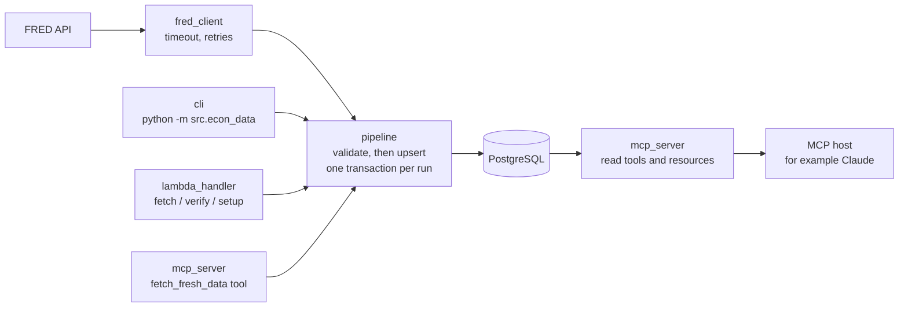

# Economic Data Pipeline

Loads US economic and market indicators from the [FRED API](https://fred.stlouisfed.org/docs/api/fred/) into PostgreSQL, and serves them to AI assistants through an [MCP](https://modelcontextprotocol.io) server.

It tracks six series: three federal funds rates, the monthly average of the funds rate, the S&P 500 and the VIX. Each run fetches the latest observations (or the full history), checks them against valid ranges, and upserts them in one database transaction, so a rerun changes nothing and a value FRED later revises is overwritten.

## Status

| | |
|---|---|
| Runs locally | Yes. Docker Compose starts PostgreSQL; the pipeline loads real FRED data. A full backfill has been run against it. |
| Tests | Unit tests, plus integration tests that run against a real PostgreSQL server. See [Tests](#tests). |
| MCP server | Works over stdio. A Streamable HTTP mode exists but is bound to localhost and has no authentication. |
| AWS | **Not deployed right now.** An earlier version of this project ran on Lambda, RDS and a VPC, and was torn down to stop the cost. Its deployment scripts were removed in the rewrite. The Lambda entry point is in the code but has not been deployed since the rewrite. |
| Scheduling, CI, monitoring | Not built yet. See [Roadmap](#roadmap). |

## Architecture



Three entry points (the command line, the Lambda handler and the MCP `fetch_fresh_data` tool) call the same pipeline. The MCP read tools and resources query the database directly and never write to it.

| Module | Job |
|---|---|
| `config` | The six indicators (id, name, units, frequency, valid range, lookback) and the settings read from environment variables and `.env`. Every other module reads from here. |
| `db` | Opens connections. Credentials come from `DB_PASSWORD`, or from AWS Secrets Manager when `DB_SECRET_ARN` is set. |
| `fred_client` | Requests observations from FRED with a timeout and retries. Fails with an error that starts with the series id and never contains the API key. |
| `validate` | Checks each date and value. |
| `pipeline` | Fetch, validate, upsert. Returns one summary per indicator. |
| `cli` | The command line, with a per-indicator table and exit codes. |
| `lambda_handler` | AWS Lambda entry point with `fetch`, `verify` and `setup` modes. |
| `mcp_server` | The MCP server. |

## Quick start

You need Python 3.11 or newer, Docker, and a free [FRED API key](https://fred.stlouisfed.org/docs/api/api_key.html).

```
git clone https://github.com/lkhavkin7/Economic_Data.git
cd Economic_Data
python -m venv .venv
```

Activate the virtual environment: `.venv\Scripts\activate` on Windows, `source .venv/bin/activate` on macOS and Linux. Then:

```
pip install -r requirements-dev.txt
```

Create your settings file from the template (`copy .env.example .env` on Windows, `cp .env.example .env` elsewhere). Open `.env` and fill in `DB_PASSWORD` (choose any password) and `FRED_API_KEY`. `.env` is ignored by git; never commit it.

Start the database and load the data:

```
docker compose up -d --wait
python -m src.econ_data --backfill
```

Check what was stored:

```
docker compose exec db psql -U econ -d econ_data -c "SELECT indicator_id, COUNT(*), MAX(date) FROM economic_indicators GROUP BY 1 ORDER BY 1"
```

From then on, `python -m src.econ_data` fetches only the latest observations.

The database schema (`db/schema.sql`) is applied only the first time the container starts with an empty data volume. `docker compose down` stops the database and keeps the data. `docker compose down -v` also deletes the data, so the next start begins from scratch.

## Configuration

Settings come from environment variables or from `.env` in the folder you run from. If both set the same value, the environment variable wins.

| Variable | Default | Meaning |
|---|---|---|
| `DB_PASSWORD` | none | Database password. Required unless `DB_SECRET_ARN` is set. |
| `DB_SECRET_ARN` | none | ARN of an AWS Secrets Manager secret holding `{"username": ..., "password": ...}`. Used only when `DB_PASSWORD` is empty. |
| `FRED_API_KEY` | none | Your FRED API key. |
| `DB_HOST` | `localhost` | Use `127.0.0.1` on Windows: `localhost` tries IPv6 first and every connection stalls. |
| `DB_PORT` | `5432` | Also the host port Docker Compose publishes the database on. |
| `DB_NAME` | `econ_data` | |
| `DB_USER` | `econ` | |

## Running the pipeline

```
python -m src.econ_data                          latest observations of every indicator
python -m src.econ_data --backfill               full history of every indicator
python -m src.econ_data --indicator DFF SP500    only the named indicators
```

Each run prints one line per indicator (example output):

```
indicator    fetched   inserted    updated  unchanged    missing   rejected  status
DFF               10          1          0          9          0          0  ok
DFEDTARU          10          0          0         10          0          0  ok
DFEDTARL          10          0          0         10          0          0  ok
FEDFUNDS           3          0          1          2          0          0  ok
SP500             10          1          0          8          1          0  ok
VIXCLS            10          1          0          9          0          0  ok

6 indicators: 6 ok, 0 failed
```

The columns of a successful run add up: `fetched = missing + rejected + inserted + updated + unchanged`.

| Exit code | Meaning |
|---|---|
| 0 | Every indicator succeeded. |
| 1 | At least one indicator failed, for example FRED returned an error. The indicators that succeeded were still saved. |
| 2 | The run could not complete: bad arguments, bad settings or a database error. Nothing from that run was saved. |

## MCP server

Tools (actions a model can call):

| Tool | Returns |
|---|---|
| `get_latest_indicator` | The newest stored observation of one indicator. |
| `get_indicator_history` | The newest stored observations of one indicator, newest first. `limit` is 1 to 1000, default 10. |
| `fetch_fresh_data` | Runs the pipeline for one indicator or `all`, and returns a summary per indicator. This is the only tool that writes. |

Resources (read-only context, addressed by URI):

| URI | Content |
|---|---|
| `fred://catalog` | Every indicator in the database, with its row count and latest date. |
| `fred://series/{indicator_id}` | The newest 100 stored observations of one indicator. |

Start it:

```
python -m src.econ_data.mcp_server          stdio, launched by an MCP host
python -m src.econ_data.mcp_server http     Streamable HTTP at http://127.0.0.1:8765/mcp
```

`mcp_config.json` is a template for an MCP host's configuration. The server reads its settings the same way the pipeline does, so either start it from the repository folder (where `.env` is) or put the real values in the `env` block of the host's configuration. Not every host expands `${...}` placeholders.

The HTTP mode has no authentication. Keep it on localhost.

## AWS Lambda entry point

`lambda_handler` in `src/econ_data/lambda_handler.py` runs the mode named by the event's `mode` key:

| Mode | Does |
|---|---|
| `fetch` (default) | Runs the pipeline for every indicator. If any indicator failed, raises an error after all have been processed, so Lambda records the invocation as failed. |
| `verify` | Returns the row count and latest date stored for each indicator. |
| `setup` | Creates the database if it is missing, then applies `db/schema.sql`. Safe to repeat. |

## Data notes

| Indicator | Series | Frequency | Valid range |
|---|---|---|---|
| `DFF` | Effective federal funds rate | daily | 0 to 25 |
| `DFEDTARU` | Federal funds target, upper limit | daily | 0 to 20 |
| `DFEDTARL` | Federal funds target, lower limit | daily | 0 to 20 |
| `FEDFUNDS` | Federal funds rate, monthly average | monthly | 0 to 25 |
| `SP500` | S&P 500 closing level | daily | 100 to 50,000 |
| `VIXCLS` | VIX closing level | daily | 5 to 100 |

The ranges live in `config`. They were checked against the full history of each series; the effective funds rate reached 22.36% in 1981, which is why its maximum is 25.

- **Revisions.** An existing row is overwritten, and its `fetched_at` renewed, only when FRED returns a different value. A row with the same value is left untouched.
- **Missing and rejected.** An observation FRED has no value for is counted as *missing* and not stored. One that fails validation is counted as *rejected*, not stored, and the first few reasons are logged. Neither is an error.
- **Daily series have no rows for market holidays.** FRED reports those days with no value.
- **S&P 500 history is short.** FRED serves only about the latest year of S&P 500 values for licensing reasons, so older observations come back as missing, even in a backfill.
- **A FRED failure for one indicator** (timeout, HTTP error, empty answer) is recorded in its summary and the other indicators still run. **A database error** stops the run and rolls back everything it wrote.

## Database schema

| Table | Holds |
|---|---|
| `indicator_metadata` | One row per indicator: id, name, description, frequency, units, source. Written by the pipeline from `config` on every run. |
| `economic_indicators` | One row per indicator per date: `value DECIMAL(15,4)` and `fetched_at`. `UNIQUE(indicator_id, date)` is what the upsert relies on. |

`db/schema.sql` only creates tables that do not exist and never deletes anything, so it is safe to apply again.

## Tests

```
python -m pytest tests                       everything
python -m pytest tests -m "not integration"  fast tests only, no database needed
python -m pytest tests -m integration        only the tests that use a real database
```

The integration tests need the Docker database running (`docker compose up -d --wait`) and the same `.env` or environment variables as the pipeline. They create and use their own database, `econ_data_test`, on the same server, and never touch `econ_data`. If the server cannot be reached they are skipped, unless the `CI` environment variable is set, in which case they fail. FRED and AWS Secrets Manager are the only things replaced by fakes.

## Troubleshooting

- **`docker compose up` fails with "forbidden by access permissions" on a port (Windows).** Another program, often a second local PostgreSQL, is using that port. Set `DB_PORT` in `.env` to a free port, for example `15432`, and start again.
- **The tests or the pipeline are very slow on Windows.** Set `DB_HOST=127.0.0.1` in `.env`.
- **FRED says the API key "is not registered" although `.env` is right.** A variable named `FRED_API_KEY` in your environment overrides `.env`. Check with `echo %FRED_API_KEY%` (cmd) or `echo $FRED_API_KEY` (macOS and Linux), remove it, and open a new terminal.
- **The database container does not turn healthy.** Run `docker compose logs db`. A common cause is a missing `DB_PASSWORD` in `.env`.

## Project layout

```
.env.example            template for .env
docker-compose.yml      local PostgreSQL
mcp_config.json         template for an MCP host's configuration
pytest.ini              test settings
requirements.txt        runtime dependencies
requirements-dev.txt    runtime plus test dependencies
db/
  schema.sql            tables
src/econ_data/          the package (see Architecture)
tests/                  unit tests
tests/integration/      tests that use a real PostgreSQL server
```

## Roadmap

- Infrastructure as code (Terraform) for the AWS deployment, with an EventBridge schedule for the daily run.
- CI: lint and tests on every push, deploy from `main`.
- Monitoring: structured logs and an alarm when the daily run fails or stores nothing.
- Authentication (OAuth 2.1) in front of the HTTP MCP server.
- Stricter validation: ranges catch impossible values but not a plausible-looking jump from one day to the next.

## Author

Leo Khavkin, [@lkhavkin7](https://github.com/lkhavkin7)